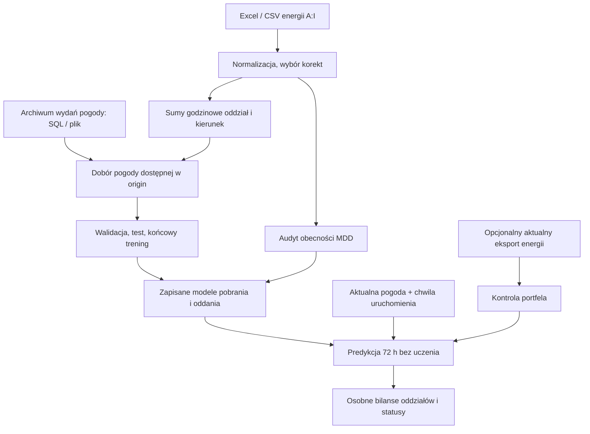

# Architektura i mapa plików

Główny przepływ to prognoza bilansów oddziałów. Starszy przepływ prognoz MDD
pozostaje dla zgodności; nie jest domyślnym wejściem do prognozy 72 h.

## Wejścia i odpowiedzialność modułów

| Plik | Rola |
|---|---|
| [`uruchom_trening_bilansow.py`](../uruchom_trening_bilansow.py) | wejście przez strzałkę VS Code; wybór plików/folderu |
| [`uruchom_prognoze_bilansow.py`](../uruchom_prognoze_bilansow.py) | powtarzalna predykcja z zapisanego modelu |
| [`uruchom_diagnostyke_godzin.py`](../uruchom_diagnostyke_godzin.py) | audyt całego eksportu F/H strzałką VS Code, bez SQL i treningu |
| [`energy_time_diagnostics.py`](../mdd_forecasting/energy_time_diagnostics.py) | wzorce godzin w dniach DST, porównanie hipotetycznych UTC i lokalne raporty źródłowe; nie ustawia konwencji modelu |
| [`branch_launcher.py`](../mdd_forecasting/branch_launcher.py) | konfiguracja ze ścieżek w kodzie, opcje CLI, opcjonalne okna tkinter |
| [`train.py`](../mdd_forecasting/train.py), [`predict.py`](../mdd_forecasting/predict.py) | modułowe wejścia CLI |
| [`branch_cli.py`](../mdd_forecasting/branch_cli.py) | opcje CLI, przepływ operacji i zapis CSV |
| [`io.py`](../mdd_forecasting/io.py), [`config.py`](../mdd_forecasting/config.py) | odczyt plików, aliasy kolumn, normalizacja i konfiguracja |
| [`branch_data.py`](../mdd_forecasting/branch_data.py) | korekty, sumy oddziałów, czas handlowy/UTC, archiwalne wydania i cutoff pogody |
| [`branch_database.py`](../mdd_forecasting/branch_database.py) | odczyt oddzielnego SQL, pyodbc i zamknięcie połączenia |
| [`pogoda_bilans_historia.sql`](../mdd_forecasting/sql/pogoda_bilans_historia.sql) | godzinowe archiwum pogody z pięcioma parametrami |
| [`branch_model.py`](../mdd_forecasting/branch_model.py) | cechy, dwa regresory, dobór wariantów, test, serializacja i prognoza |
| [`branch_diagnostics.py`](../mdd_forecasting/branch_diagnostics.py) | diagnostyka odłożonego testu, porównanie z profilem, raport Excel i wykresy |
| [`portfolio.py`](../mdd_forecasting/portfolio.py) | obecność MDD, przerwy, zmiany zestawów i statusy portfela |
| [`oddzial_miasto.csv`](../mdd_forecasting/config/oddzial_miasto.csv) | przypisanie oddziałów do punktów pogody |

`database.py`, `features.py` i części `io.py` są współdzielone ze starszym
przepływem. Zmieniając je, sprawdź oba zastosowania.
`cli.py`, `model.py`, `report.py`, `__main__.py` i `uruchom_model.py`
obsługują starszy przepływ MDD. Opisuje go [README pakietu](../mdd_forecasting/README.md).

## Ważne kontrakty

- `load_branch_energy()` zwraca sumy godzinowe, kontrolę jakości i mapowanie.
  `return_measurements=True` dodaje wybrane pomiary MDD do audytu.
  `exclude_dst_days=True` wyłącza kalendarzowe doby 23/25 h po start_date i
  przed walidacją; CLI treningu domyślnie ustawia ten filtr.
  `return_excluded_days=True` dodaje raport wykluczeń na końcu wyniku.
  `load_prediction_measurements()` używa filtra zapisanego w `input_schema`
  i opcjonalnie zwraca raport przez `return_excluded_days=True`.
- `prepare_weather_vintages()` zachowuje wydania i normalizuje czasy.
  `join_weather_asof()` wybiera najnowsze wydanie dla punktu i celu z czasem
  dostępności nie większym niż origin. Nie wybiera pogody osobno względem czasu celu.
- `historical_requests()` buduje symulowane uruchomienia, domyślnie co 12 h.
  `future_requests()` zaczyna od następnej pełnej godziny i odlicza godziny w UTC.
- `train_branch_models()` dobiera modele i zwraca raporty. `save_bundle()`
  zapisuje `modele_oddzialow.joblib` oraz `manifest_oddzialy.json`.
  Format zapisu to obecnie 3; odczyt dopuszcza 1, 2 i 3.
- `load_bundle()` wymaga tej samej wersji scikit-learn co trening.
  `predict_branches()` wymaga origin po końcu historii treningowej i horyzontu
  nie większego niż treningowy. Nie wykonuje uczenia. Wybrany CatBoost wymaga
  tej samej wersji CatBoost co trening.
- `analyze_portfolio()` operuje na pomiarach wybranych po korektach.
  `ignored_dates` wyłącza celowo pominięte doby z liczenia przerw i opóźnień MDD.
  `annotate_portfolio()` porównuje aktualny eksport z portfelem treningowym,
  jeśli został dostarczony. Nie modyfikuje prognozowanych wolumenów.

## Artefakty i statusy

Model i manifest przenosi się razem. Zapis obejmuje modele, kolumny cech,
ustawienia, oddziały, profil odniesienia i informacje do audytu portfela.
Nie zastępuj dopasowanego mapowania przypadkowo zmienionym słownikiem przy predykcji.

Szczegóły raportów treningu są w [instrukcji](../START_BILANSY_72H.md#wyniki).
Predykcja zapisuje `prognoza_bilansu_72h.csv`, `szczegoly_prognozy.csv`
i dostępne raporty portfela. Liczba bilansów wynosi `liczba oddziałów modelu × horyzont`.
Przy ośmiu oddziałach i 72 h to 576, także w okresie zmiany czasu.
Trening zapisuje też `pominiete_dni_zmiany_czasu.csv` i arkusz `Pominiete_doby`;
format modelu pozostaje 3, z flagą `input_schema.exclude_dst_days`.

CSV: separator `;`, przecinek dziesiętny, UTF-8 BOM.
`status` opisuje dostępność prognozy, `status_portfela` opisuje kontrolę MDD.
Brak wymaganej pogody zostawia brak prognozy i status, a CLI kończy z kodem 2.
Wybrany wariant wyłącznie kalendarzowy może prognozować bez pogody.
Kod 0 nie jest potwierdzeniem aktualnych umów ani dokładności prognozy.

## Gdzie sprawdzać zmiany

| Test | Zakres |
|---|---|
| [`test_branch_forecasting.py`](../tests/test_branch_forecasting.py) | korekty, sumy, pogoda as-of, DST, uczenie/zapis/odczyt i predykcja bez fit |
| [`test_portfolio.py`](../tests/test_portfolio.py) | przerwy, powroty, zera, podmiana MDD przy tej samej liczbie i statusy |
| [`test_mdd_forecasting.py`](../tests/test_mdd_forecasting.py) | współdzielone elementy i starszy przepływ |
| [`test_branch_training_tools.py`](../tests/test_branch_training_tools.py) | konfiguracja ścieżek, luki, kierunek wyłącznie z B mimo opisów E, pokrycie testu, statystyki/Excel, częściowa pogoda i opcjonalny CatBoost |
| [`test_branch_mapping.py`](../tests/test_branch_mapping.py) | kodowania i separatory CSV, walidacja mapowania, ścieżki, aliasy Łodzi i audyt z zapisanym mapowaniem |
| [`test_energy_input_diagnostics.py`](../tests/test_energy_input_diagnostics.py) | oryginalne F/H i przyczyny błędów, 25 godzin jesienią, rozpoznawanie SQL/eksportu pogody |
| [`test_energy_hour_audit.py`](../tests/test_energy_hour_audit.py) | oba wiosenne wzorce, nierozstrzygająca jesień, braki/zera/konflikty, rozdzielenie serii i korekt, odczyt CSV/XLSX oraz raport bez zmiany wejścia |
| [`test_dst_day_exclusion.py`](../tests/test_dst_day_exclusion.py) | całe doby 23/25 h, walidacja zwykłych dni, UTC bez kompresji, audyt bez fałszywych przerw, zapis reguły i trening bez wyłączonych celów w teście |

Przykłady poleceń są w instrukcji i skillach. Aktualny zestaw opcji sprawdzisz przez
`python -m mdd_forecasting.train --help` oraz
`python -m mdd_forecasting.predict --help`.
