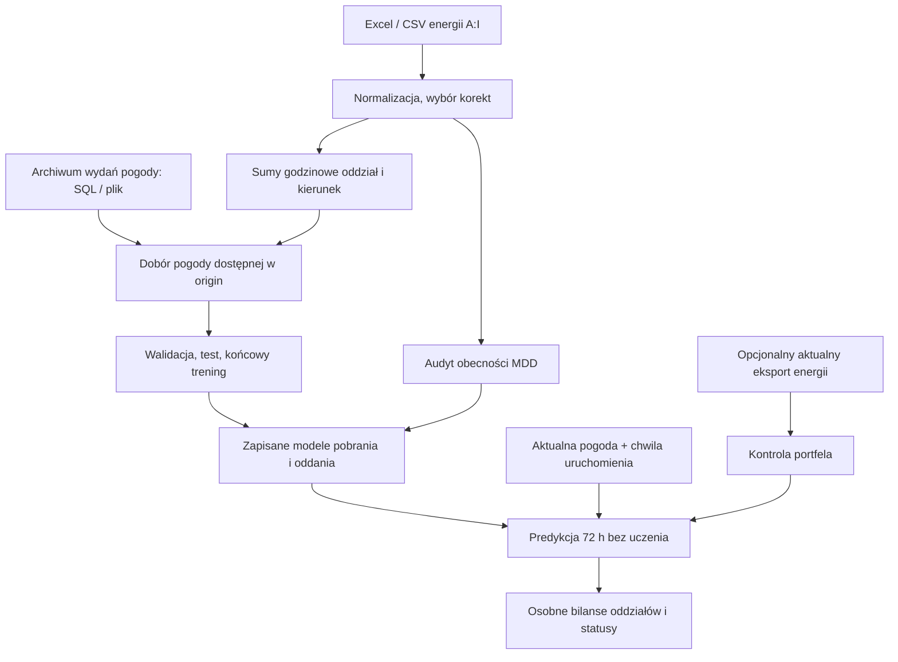

# Architektura i mapa plików

Główny przepływ to prognoza bilansów oddziałów. Starszy przepływ prognoz MDD
pozostaje dla zgodności; nie jest domyślnym wejściem do prognozy 72 h.

## Wejścia i odpowiedzialność modułów

| Plik | Rola |
|---|---|
| [`uruchom_trening_bilansow.py`](../uruchom_trening_bilansow.py) | wejście przez strzałkę VS Code; wybór plików/folderu |
| [`uruchom_prognoze_bilansow.py`](../uruchom_prognoze_bilansow.py) | powtarzalna predykcja z zapisanego modelu |
| [`uruchom_backtest_bilansow.py`](../uruchom_backtest_bilansow.py) | strzałka VS Code: daty, te same parametry modelu, domyślnie bez limitu czasu |
| [`backtest.py`](../mdd_forecasting/backtest.py) | oddzielenie historii treningowej, produkcyjny trening, zamrożone prognozy późniejszych origins, cache i postęp |
| [`backtest_runtime.py`](../mdd_forecasting/backtest_runtime.py) | nadzorowany proces z limitem czasu i blokadą folderu, także na Windows |
| [`backtest_report.py`](../mdd_forecasting/backtest_report.py) | ocena zewnętrzna, CSV, Excel oraz samodzielny interaktywny HTML |
| [`branch_launcher.py`](../mdd_forecasting/branch_launcher.py) | konfiguracja ze ścieżek w kodzie, opcje CLI, opcjonalne okna tkinter |
| [`train.py`](../mdd_forecasting/train.py), [`predict.py`](../mdd_forecasting/predict.py) | modułowe wejścia CLI |
| [`branch_cli.py`](../mdd_forecasting/branch_cli.py) | opcje CLI, przepływ operacji i zapis CSV |
| [`io.py`](../mdd_forecasting/io.py), [`config.py`](../mdd_forecasting/config.py) | odczyt plików, aliasy kolumn, normalizacja i konfiguracja |
| [`branch_data.py`](../mdd_forecasting/branch_data.py) | korekty, sumy oddziałów, czas handlowy/UTC, archiwalne wydania i cutoff pogody |
| [`branch_database.py`](../mdd_forecasting/branch_database.py) | odczyt oddzielnego SQL, pyodbc i zamknięcie połączenia |
| [`pogoda_bilans_historia.sql`](../mdd_forecasting/sql/pogoda_bilans_historia.sql) | godzinowe archiwum pogody z pięcioma parametrami |
| [`branch_model.py`](../mdd_forecasting/branch_model.py) | cechy, dwa regresory, dobór wariantów, test, serializacja i prognoza |
| [`branch_diagnostics.py`](../mdd_forecasting/branch_diagnostics.py) | diagnostyka odłożonego testu, porównanie z profilem, raport Excel i wykresy |
| [`weather_quality.py`](../mdd_forecasting/weather_quality.py) | kompletność, zakresy i wiek pogody; rekomendacje wariantów wyłącznie z walidacji |
| [`weather_time.py`](../mdd_forecasting/weather_time.py) | pierwszeństwo źródłowego UTC, jednoznaczna konwersja CET i raport rozbieżności metadanych |
| [`energy_filter.py`](../mdd_forecasting/energy_filter.py) | progi wysokich pomiarów MDD przed walidacją, wykluczenia i raporty, zapis reguły do audytu |
| [`portfolio.py`](../mdd_forecasting/portfolio.py) | obecność MDD, przerwy, zmiany zestawów i statusy portfela |
| [`oddzial_miasto.csv`](../mdd_forecasting/config/oddzial_miasto.csv) | przypisanie oddziałów do punktów pogody |

`database.py`, `features.py` i części `io.py` są współdzielone ze starszym
przepływem. Zmieniając je, sprawdź oba zastosowania.
`cli.py`, `model.py`, `report.py`, `__main__.py` i `uruchom_model.py`
obsługują starszy przepływ MDD. Opisuje go [README pakietu](../mdd_forecasting/README.md).

## Ważne kontrakty

- `load_branch_energy()` zwraca sumy godzinowe, kontrolę jakości i mapowanie.
  `return_measurements=True` dodaje wybrane pomiary MDD do audytu.
  `exclude_dst_days=True` wyłącza kalendarzowe doby 23/25 h po start_date i
  przed walidacją; CLI treningu domyślnie ustawia ten filtr.
  `return_excluded_days=True` dodaje raport wykluczeń na końcu wyniku.
  `end_date` opcjonalnie ogranicza odczytaną historię przed walidacją; daty
  nierozpoznane nie są po cichu odrzucane.
  `exclude_negative_energy=True` wyklucza ujemne I po wyborze korekty, zachowując
  rekord i pierwotną wartość. CLI domyślnie włącza; niskopoziomowy odczyt jest
  domyślnie ścisły dla zgodności. `sum_branch_measurements()` liczy pełne sumy
  z wybranych wersji i nie pomija brakujących składników przy sumowaniu.
  `load_prediction_measurements()` używa filtra zapisanego w `input_schema`
  i opcjonalnie zwraca raport przez `return_excluded_days=True`.
  `return_filter_reports=True` zwraca pomiary, wyłączone doby i raporty filtra.
- `prepare_training_energy()` ustala granicę podziału jak historyczne zlecenia
  pogodowe i kalibruje progi tylko na pomiarach przed walidacją i embargo.
  Core otrzymuje zamrożony `split_cutoff`, aby wykluczenie końca historii nie
  przesuwało walidacji do referencji filtra. `energy_filter` jest zapisany
  w modelu. Backtest i audyt stosują te progi bez ponownego dopasowania.
- `prepare_weather_vintages()` zachowuje wydania i normalizuje czasy do UTC.
  Poprawne `dataGodzinaUTC` i `czasDanychZrodlaUTC` mają pierwszeństwo przed
  CET i kluczem handlowym. Brak UTC dopuszcza tylko jednoznaczną konwersję
  lokalnego czasu; błędne jawne UTC zatrzymuje odczyt z raportem oryginałów.
  Brak punktu i cel poza pełną godziną również są błędami, nie cichym filtrem.
  Identyczne wersje zostają do audytu i są deduplikowane przy łączeniu;
  sprzeczne cechy tego samego punktu/celu/wydania nadal przerywają odczyt.
  `join_weather_asof()` wybiera najnowsze wydanie dla punktu i celu z czasem
  dostępności nie większym niż origin. Nie wybiera pogody osobno względem czasu celu.
- Nowy SQL ma znacznik `-- PGEO_VALID_RANGE: UTC` i filtruje cel po UTC.
  Bez znacznika adapter zachowuje dotychczasowy kontrakt parametrów CET,
  konwertując przekazane przez aplikację granice UTC. Nie zmieniaj kontraktu
  własnej kwerendy przez samo dodanie znacznika do filtra nadal używającego CET.
- `historical_requests()` buduje symulowane uruchomienia, domyślnie co 12 h.
  `future_requests()` zaczyna od następnej pełnej godziny i odlicza godziny w UTC.
- `train_branch_models()` dobiera modele i zwraca raporty. `save_bundle()`
  zapisuje `modele_oddzialow.joblib` oraz `manifest_oddzialy.json`.
  Format zapisu to obecnie 4; odczyt dopuszcza 1, 2, 3 i 4.
  Opcjonalne `trial_cache` i `progress` służą wznowieniu gotowych wyników
  walidacji w backteście; nie zmieniają grida, wyboru ani obowiązkowych refitów.
  Cache jest izolowany skrótem pełnych wejść, kodu, parametrów i wersji, a próby
  są związane z konkretnym snapshotem pogody. Nie przekazuj obcego cache.
  `auto` obejmuje HistGradientBoosting i dostępne CatBoost/LightGBM/XGBoost.
  Opcjonalny `ValidationEnsemble` dopasowuje dwa modele i używa wag wybranych
  wyłącznie na wcześniejszej walidacji. Refit członków zachowuje te same odcięcia.
- `load_bundle()` wymaga tej samej wersji scikit-learn co trening.
  `predict_branches()` wymaga origin po końcu historii treningowej i horyzontu
  nie większego niż treningowy. Nie wykonuje uczenia. Wszystkie użyte biblioteki,
  również wewnątrz zespołu, wymagają zgodnej wersji zapisanej w manifeście.
- `analyze_portfolio()` operuje na pomiarach wybranych po korektach.
  `ignored_dates` wyłącza celowo pominięte doby z liczenia przerw i opóźnień MDD.
  `annotate_portfolio()` porównuje aktualny eksport z portfelem treningowym,
  jeśli został dostarczony. Nie modyfikuje prognozowanych wolumenów.

## Artefakty i statusy

Model i manifest przenosi się razem. Zapis obejmuje modele, kolumny cech,
ustawienia, oddziały, profil odniesienia i informacje do audytu portfela.
Nie zastępuj dopasowanego mapowania przypadkowo zmienionym słownikiem przy predykcji.

Szczegóły raportów treningu są w [instrukcji](../START_BILANSY_72H.md#wyniki).
Predykcja zapisuje `prognoza_bilansu_72h.csv`, `szczegoly_prognozy.csv`
i dostępne raporty portfela. Liczba bilansów wynosi `liczba oddziałów modelu × horyzont`.
Przy ośmiu oddziałach i 72 h to 576, także w okresie zmiany czasu.
Trening zapisuje też `pominiete_dni_zmiany_czasu.csv` i arkusz `Pominiete_doby`;
format modelu 4 zachowuje flagę `input_schema.exclude_dst_days`.

CSV: separator `;`, przecinek dziesiętny, UTF-8 BOM.
`status` opisuje dostępność prognozy, `status_portfela` opisuje kontrolę MDD.
Brak wymaganej pogody zostawia brak prognozy i status, a CLI kończy z kodem 2.
Wybrany wariant wyłącznie kalendarzowy może prognozować bez pogody.
Kod 0 nie jest potwierdzeniem aktualnych umów ani dokładności prognozy.

## Gdzie sprawdzać zmiany

| Test | Zakres |
|---|---|
| [`test_branch_forecasting.py`](../tests/test_branch_forecasting.py) | korekty, sumy, pogoda as-of, DST, uczenie/zapis/odczyt i predykcja bez fit |
| [`test_weather_utc.py`](../tests/test_weather_utc.py) | pierwszeństwo UTC, metadane CET/H25, jednoznaczna konwersja, błędy czasu i kontrakty parametrów SQL |
| [`test_portfolio.py`](../tests/test_portfolio.py) | przerwy, powroty, zera, podmiana MDD przy tej samej liczbie i statusy |
| [`test_mdd_forecasting.py`](../tests/test_mdd_forecasting.py) | współdzielone elementy i starszy przepływ |
| [`test_branch_training_tools.py`](../tests/test_branch_training_tools.py) | konfiguracja ścieżek, luki, kierunek wyłącznie z B mimo opisów E, pokrycie testu, statystyki/Excel, częściowa pogoda i opcjonalny CatBoost |
| [`test_branch_mapping.py`](../tests/test_branch_mapping.py) | kodowania i separatory CSV, walidacja mapowania, ścieżki, aliasy Łodzi i audyt z zapisanym mapowaniem |
| [`test_energy_input_diagnostics.py`](../tests/test_energy_input_diagnostics.py) | oryginalne F/H i przyczyny błędów, 25 godzin jesienią, rozpoznawanie SQL/eksportu pogody |
| [`test_dst_day_exclusion.py`](../tests/test_dst_day_exclusion.py) | całe doby 23/25 h, walidacja zwykłych dni, UTC bez kompresji, audyt bez fałszywych przerw, zapis reguły i trening bez wyłączonych celów w teście |
| [`test_backtest.py`](../tests/test_backtest.py) | zgodność prognoz z produkcją, chronologia, embargo, odcięcie przyszłej energii/pogody, cache, raporty i twardy limit czasu |
| [`test_model_selection.py`](../tests/test_model_selection.py) | rzeczywisty LightGBM/XGBoost i zapis zespołu, wybór wag na walidacji, miesiące z latami, błędy godzinowe i kontrola pogody |
| [`test_energy_filter.py`](../tests/test_energy_filter.py) | ujemne po korektach, brak częściowej sumy, próg MDD bez przyszłości, zera i nowa seria, stałe okna, trening/backtest/audyt i raporty |

Zewnętrzny backtest opisuje [BACKTEST.md](../BACKTEST.md). Trenuje raz na
osobnym zakresie, następnie wywołuje `predict_branches()` dla kolejnych origins.
Poza chwilą treningu nie ma fitów ani aktualizacji profilu. Statusy braków
i cele DST są zachowane w pełnym eksporcie; DST nie wchodzą do mianownika oceny.
Podfolder `trening/` zawiera wewnętrzny test i model, raport główny dotyczy
wyłącznie późniejszego okresu. Dawna osobna diagnostyka godzin została usunięta.

Przykłady poleceń są w instrukcji i skillach. Aktualny zestaw opcji sprawdzisz przez
`python -m mdd_forecasting.train --help` oraz
`python -m mdd_forecasting.predict --help`.
